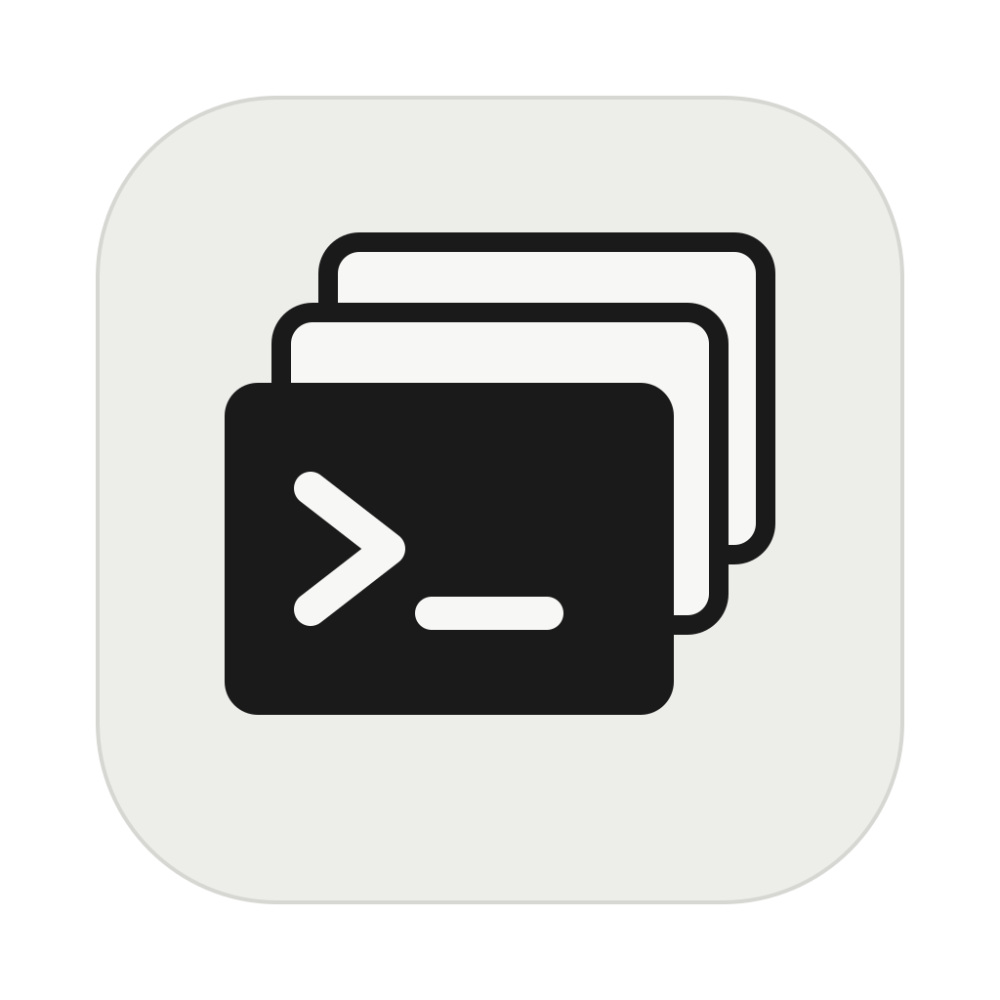
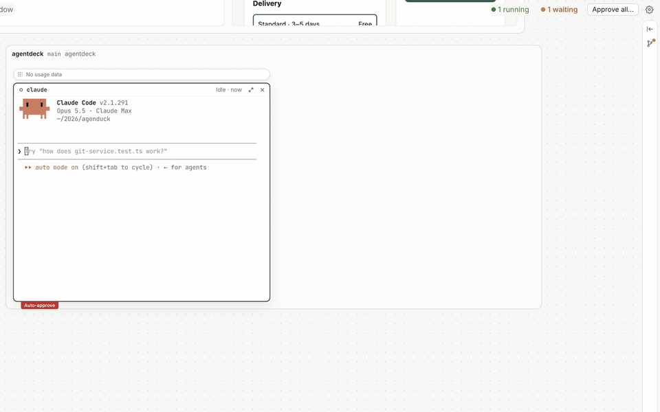
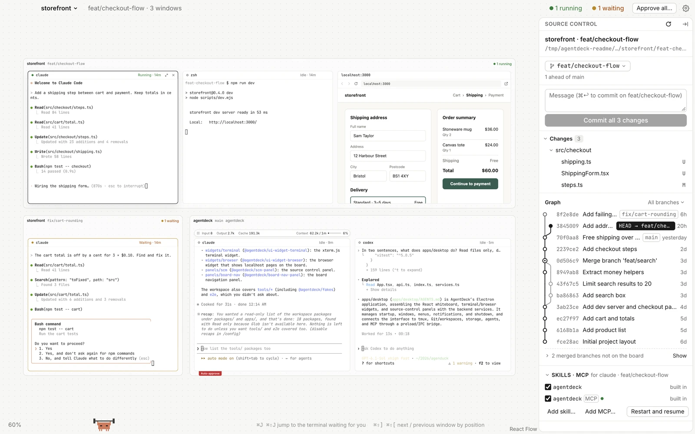
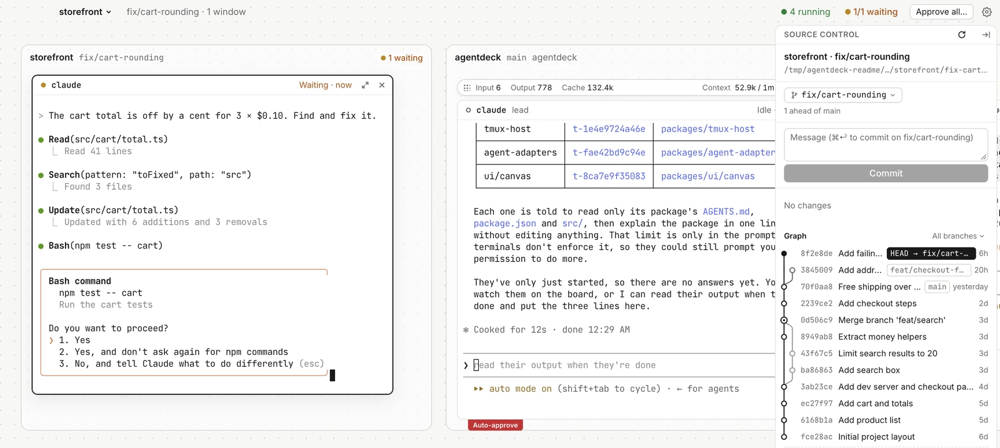
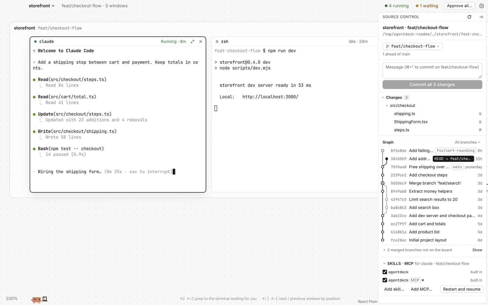
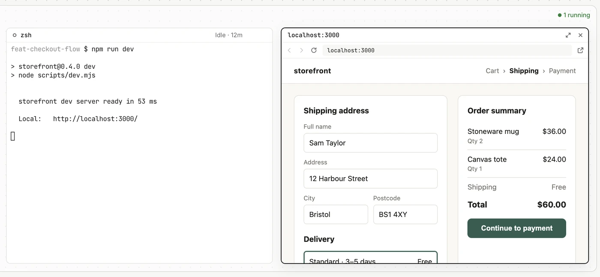
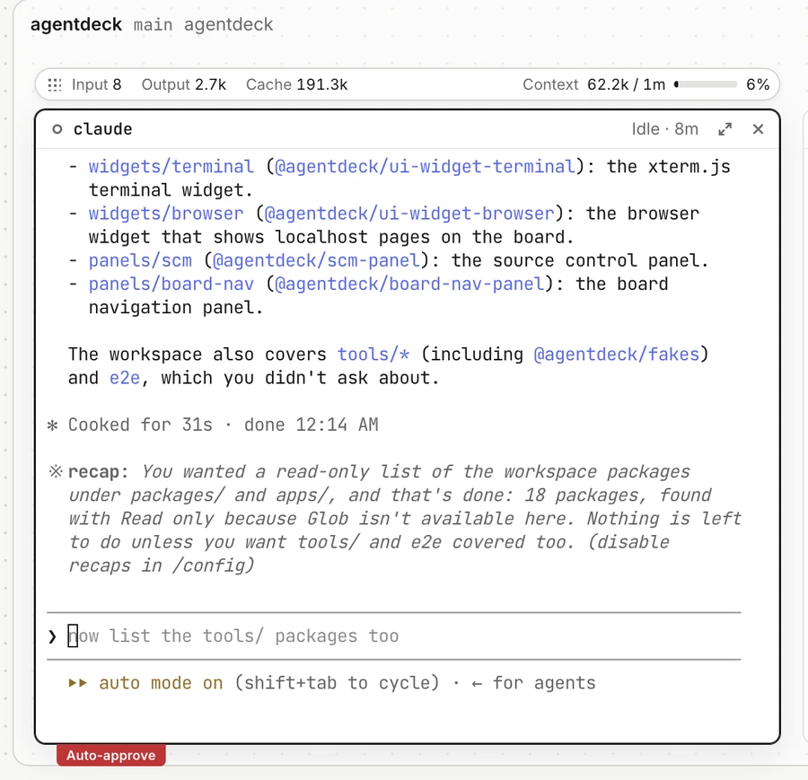

<div align="center">



# AgentDeck

複数のコーディングエージェントを 1 枚のホワイトボードで並べて動かす。ブランチごとに git worktree を 1 つ。

<a href="https://github.com/Loveforwa/AgentDeck/releases/latest"></a>

macOS（Apple シリコンまたは Intel）· [tmux](https://github.com/tmux/tmux) 3.5 以上と、使いたいエージェントが必要 · [署名されていないアプリの開き方](#インストール)

[English](../../README.md) · [简体中文](README.zh-CN.md) · **日本語** · [한국어](README.ko.md) · [Español](README.es.md) · [Français](README.fr.md) · [Deutsch](README.de.md)

</div>

<p align="center">
  
</p>

AgentDeck は、Claude Code、Codex、Pi、Oh My Pi、Kimi と普通のシェルを同時に使うためのデスクトップアプリです。ターミナルはどれも本物の TUI セッションで、ズームできるボードの上に置かれます。作業するブランチごとにフレームが 1 つでき、それぞれ専用の git worktree を持つので、同じリポジトリで複数のエージェントが作業してもお互いのファイルには触れません。

AgentDeck は Mac にインストール済みのエージェントをそのまま使います。エージェントを同梱することも、グローバル設定を書き換えることもありません。フックと AgentDeck の MCP サーバーは起動引数で渡します。

## できること

### ブランチごとにフレーム

<picture>
  <source media="(prefers-color-scheme: dark)" srcset="../images/overview-dark.webp">
  
</picture>

プロジェクトを追加してブランチを選ぶと、AgentDeck が worktree を作り、ボードにフレームを置きます。フレームの中で開いたターミナルや Web ウィンドウは、そのフォルダーから始まります。ターミナルは AgentDeck 専用の tmux サーバーで動くので、ウィンドウを閉じても動き続けます。再起動のあとは前回のセッションを復元するか聞かれ、エージェントは会話の続きから、シェルは同じフォルダーで開き直します。

### どのエージェントが待っているか分かる

<picture>
  <source media="(prefers-color-scheme: dark)" srcset="../images/status-dark.webp">
  
</picture>

ターミナルにはそれぞれステータスランプがあります。実行中は緑、あなたの操作待ちは黄、エラーは赤。トップバーに件数が出ます。⌘J で次の待機中のターミナルへ、⌘⇧J で前へ移動します。

### ボードの隣にソース管理

<picture>
  <source media="(prefers-color-scheme: dark)" srcset="../images/source-control-dark.webp">
  
</picture>

右のパネルはフォーカス中のターミナルに合わせて切り替わります。その worktree の変更ファイル、ステージとコミット、ブランチの切り替え、全ブランチのコミットグラフ。下の Skills · MCP では、そのターミナルのエージェントが起動時に読み込む skill と MCP サーバーを確認できます。

### ローカルのページをボードで開く

<picture>
  <source media="(prefers-color-scheme: dark)" srcset="../images/web-window-dark.webp">
  
</picture>

ターミナルの `localhost` リンクをクリックすると、ページが同じフレームの Web ウィンドウとして開きます。同じリンクをもう一度クリックすると、そのウィンドウが前に出ます。

### エージェント自身もウィンドウを開ける

AgentDeck はローカルで MCP サーバーを動かし、Claude Code、Codex、Oh My Pi を起動するときに接続します。エージェントはこれを使って、ターミナルや worktree、Web ウィンドウを開いたり、別のターミナルの出力を読んだり、サブエージェントをまとめて起動したりできます。上の GIF のプロンプトは "use the agentdeck open_terminals tool to open 3 claude subagents, one per package" です。

### プラグイン

<picture>
  <source media="(prefers-color-scheme: dark)" srcset="../images/plugins-dark.webp">
  
</picture>

プラグインはターミナルの右クリックメニューにあります。Auto-approve はフレーム単位でもオンにでき、その中のエージェントすべてに効きます。

- **Auto-approve**：権限の確認に「今回だけ許可」で答えます。破壊的なコマンド（`rm -rf`、`git push --force` など）、選択式の質問、入力が必要な質問はこれまでどおりあなたを待ちます。
- **Usage**：入力・出力・キャッシュのトークン数と、コンテキストの使用量を表示します。データはエージェント自身のローカルのセッションファイルから読みます。

## インストール

1. [最新リリース](https://github.com/Loveforwa/AgentDeck/releases/latest)からお使いの Mac 用の `.dmg`（Apple シリコンは `arm64`、Intel は `x64`）をダウンロードし、AgentDeck を「アプリケーション」にドラッグします。
2. tmux 3.5 以降と git をインストールします。
   ```sh
   brew install tmux
   xcode-select --install   # git がまだない場合
   ```
3. 使いたいエージェントをインストールし、普通のターミナルでそれぞれ一度ログインしておきます（`claude`、`codex`、`pi`、`omp`、`kimi`）。AgentDeck はログインシェルの `PATH` からこれらを見つけます。
4. AgentDeck を開きます。アプリは公証されていないため、最初の起動は macOS にブロックされます。
   - 「アプリケーション」で AgentDeck を右クリックし、**開く** を選んで、もう一度 **開く** をクリックします。
   - macOS 15 以降では、一度開こうとしてから **システム設定 › プライバシーとセキュリティ** で **このまま開く** をクリックします。
   - または隔離属性を外します：`xattr -dr com.apple.quarantine /Applications/AgentDeck.app`

AgentDeck のデータ（ボード、設定、worktree）は `~/.agentdeck` に保存されます。

## ソースからビルド

macOS、Node.js 22.12 以上、pnpm 10、tmux 3.5 以上、git が必要です。

```sh
pnpm install
node apps/desktop/node_modules/electron/install.js   # 初回のみ：Electron をダウンロード

pnpm dev     # ソースから起動（データは .agentdeck-dev/、tmux サーバーも別）
pnpm check   # 型チェック、lint、色とモジュール境界のチェック、ユニットテスト
pnpm e2e     # Playwright による E2E テスト（アプリのウィンドウが開きます）
pnpm dist    # .dmg を apps/desktop/dist/ に作成
```

コードは pnpm のモノレポです。アプリは Electron と React、ターミナルは xterm.js、ボードは React Flow。各パッケージの役割はそれぞれの `AGENTS.md` に書かれていますが、内部ドキュメントの多くは中国語です。

## ライセンス

[MIT](../../LICENSE)
